# Bug fix screenshots

**TL;DR:** Evidence for nine bug fixes on `tc/service-bug-fixes`, for [#20](https://github.com/tahmidachoudhury/aks-v2-platform/issues/20). Each bug has three images. "Before" shows the bug on `main` (574859d). "Fix" shows the key lines of the change. "After" shows the same scenario on the branch at 2a885c2. The four commits after it (12edbc5, 8c9a640, ce76f7a, 4063259) do not change any scenario shown here. Before and after were captured from the running stack under docker compose. JWTs and the webhook secret are truncated.

Most images are terminal panels showing the request and the real output. The fix images are trimmed diffs: `...` marks lines left out. The #129 UI images show the dashboard in Chromium, with the page's own requests listed underneath.

Since e467409, tokens carry a role. Only an admin can read the dashboard, add products, reserve stock, charge, refund or create shipments. Compose makes `admin@platform.local` an admin, so the after scenarios sign in as that admin for those calls. The before scenarios used alice or bob.

[#134](https://github.com/tahmidachoudhury/aks-v2-platform/issues/134) (delivered orders never deduct stock) is a known open bug. It is not part of this set.

## #122: dashboard routes return 404 through the gateway

[#122](https://github.com/tahmidachoudhury/aks-v2-platform/issues/122). `GET /api/dashboard/summary` with a JWT returns 404, because the gateway strips `/api/dashboard` and dashboard-api only serves `/dashboard/...`.

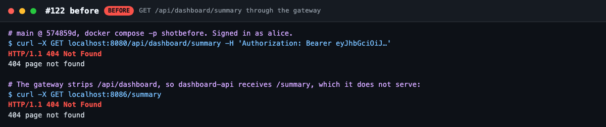

The gateway now proxies `/api/dashboard` to dashboard-api's `/dashboard` path ([4835113](https://github.com/tahmidachoudhury/aks-v2-platform/commit/4835113)).

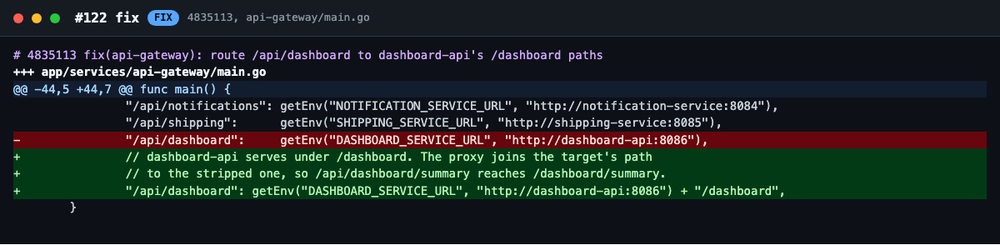

After, the same request returns the summary JSON, signed in as the admin.

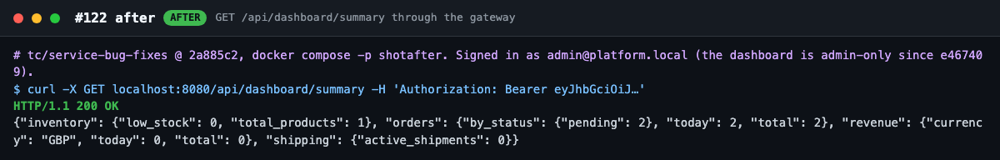

## #129: dashboard data has no auth

[#129](https://github.com/tahmidachoudhury/aks-v2-platform/issues/129). `:8086/dashboard/summary` and `/dashboard/revenue` return revenue and order data with no token.

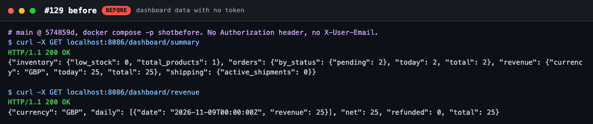

dashboard-api now rejects `/dashboard/*` without the identity the gateway sets ([12319b9](https://github.com/tahmidachoudhury/aks-v2-platform/commit/12319b9)), and only serves it to role `admin` ([e467409](https://github.com/tahmidachoudhury/aks-v2-platform/commit/e467409)). The gateway serves the UI page at `/` without a JWT, so the page and its API calls share one origin.

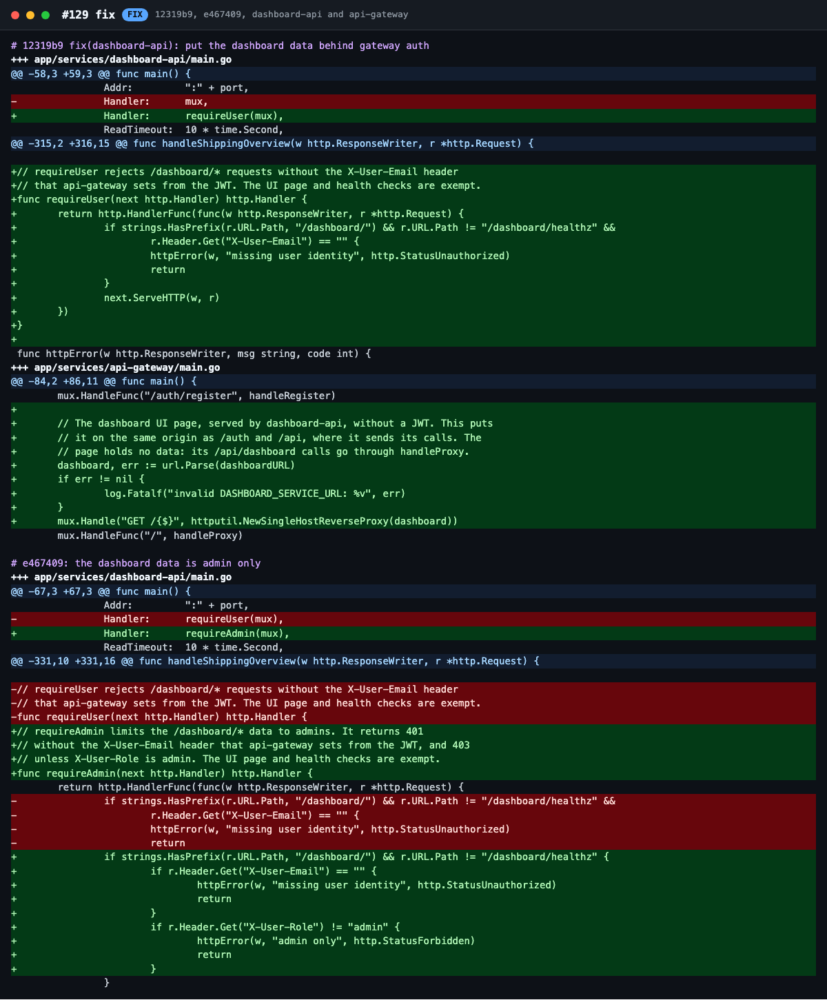

After, it returns 401 straight to dashboard-api, 401 through the gateway without a JWT, 403 for alice (a customer) and 200 for the admin.

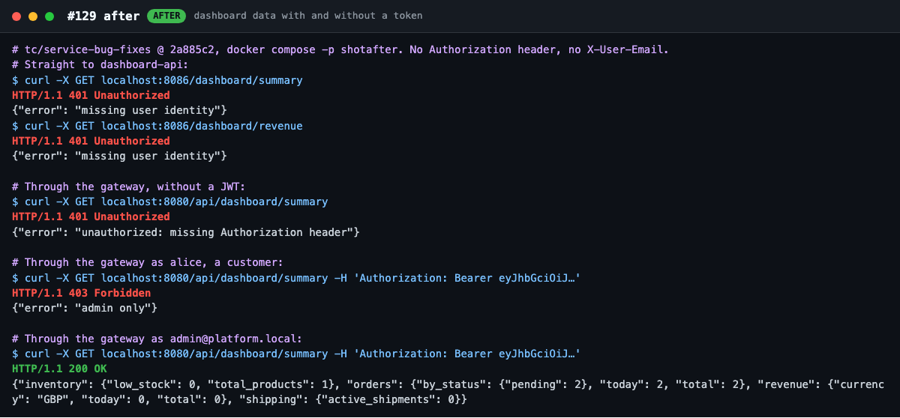

### Dashboard UI

On `main`, `:8080/` returns 401. `:8086/` shows the stats with no login, while every `/auth` and `/api` call returns 404.

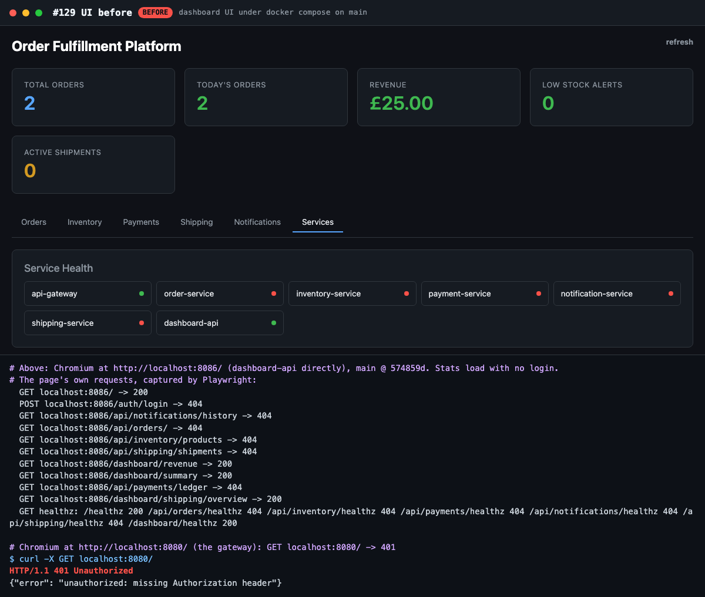

The page only logged in when it had no saved token, so an expired token, or one signed with an old secret, left it empty. Its API calls now go through one helper that logs in again on a 401 and retries once ([dcb3d8c](https://github.com/tahmidachoudhury/aks-v2-platform/commit/dcb3d8c)). On load it also drops a saved token whose role is not admin, which would get 403 rather than 401 ([2a885c2](https://github.com/tahmidachoudhury/aks-v2-platform/commit/2a885c2)).

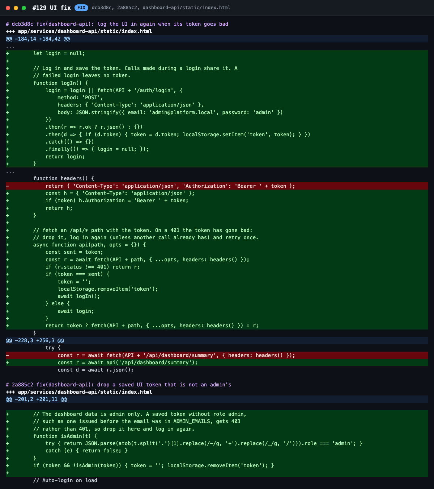

After, `:8080/` serves the page, it logs in as the admin, and every call and health dot is green.

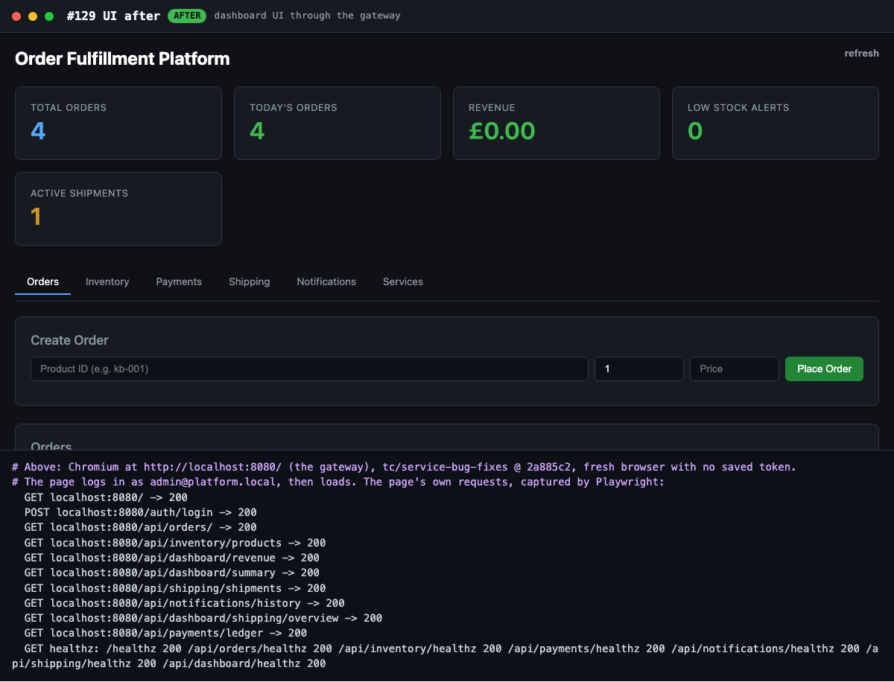

With an expired admin token in localStorage, the first six calls get 401. The page logs in once, retries them and loads. With a garbage token or alice's customer token, the page drops it before any call, logs in and loads.

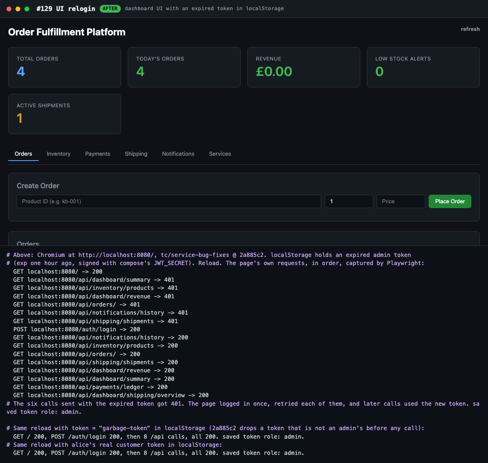

## #125: JWT_SECRET falls back to a public default

[#125](https://github.com/tahmidachoudhury/aks-v2-platform/issues/125). The gateway starts with an empty `JWT_SECRET`, and a token forged with `change-me-in-production` reads alice's orders.

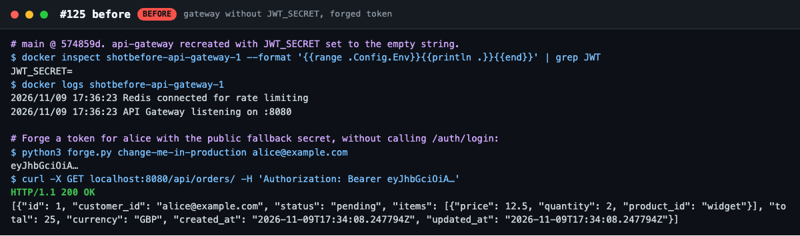

The gateway now exits if `JWT_SECRET` is unset or empty ([d7c34b3](https://github.com/tahmidachoudhury/aks-v2-platform/commit/d7c34b3)).

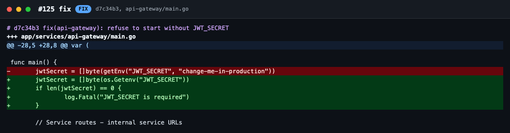

After, the gateway exits with `JWT_SECRET is required`, and the forged token gets 401.

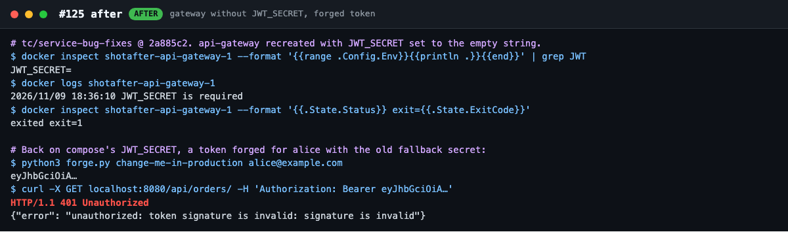

## #128: rate limit key comes from X-Forwarded-For

[#128](https://github.com/tahmidachoudhury/aks-v2-platform/issues/128). 150 requests, each with a new forged `X-Forwarded-For`, all return 200 and make 150 Redis keys.

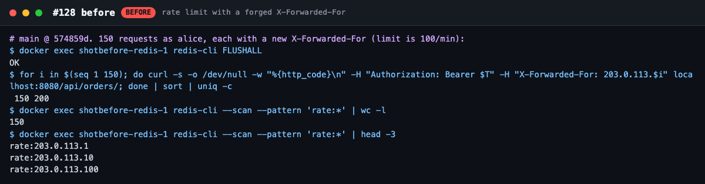

The rate limit reads `X-Forwarded-For` only from a proxy in `TRUSTED_PROXIES`, then takes the right-most untrusted hop ([bd28ecc](https://github.com/tahmidachoudhury/aks-v2-platform/commit/bd28ecc)). The gateway no longer overwrites the header with `ip:port` when proxying, so the chain reaches the backends intact ([dd53263](https://github.com/tahmidachoudhury/aks-v2-platform/commit/dd53263)).

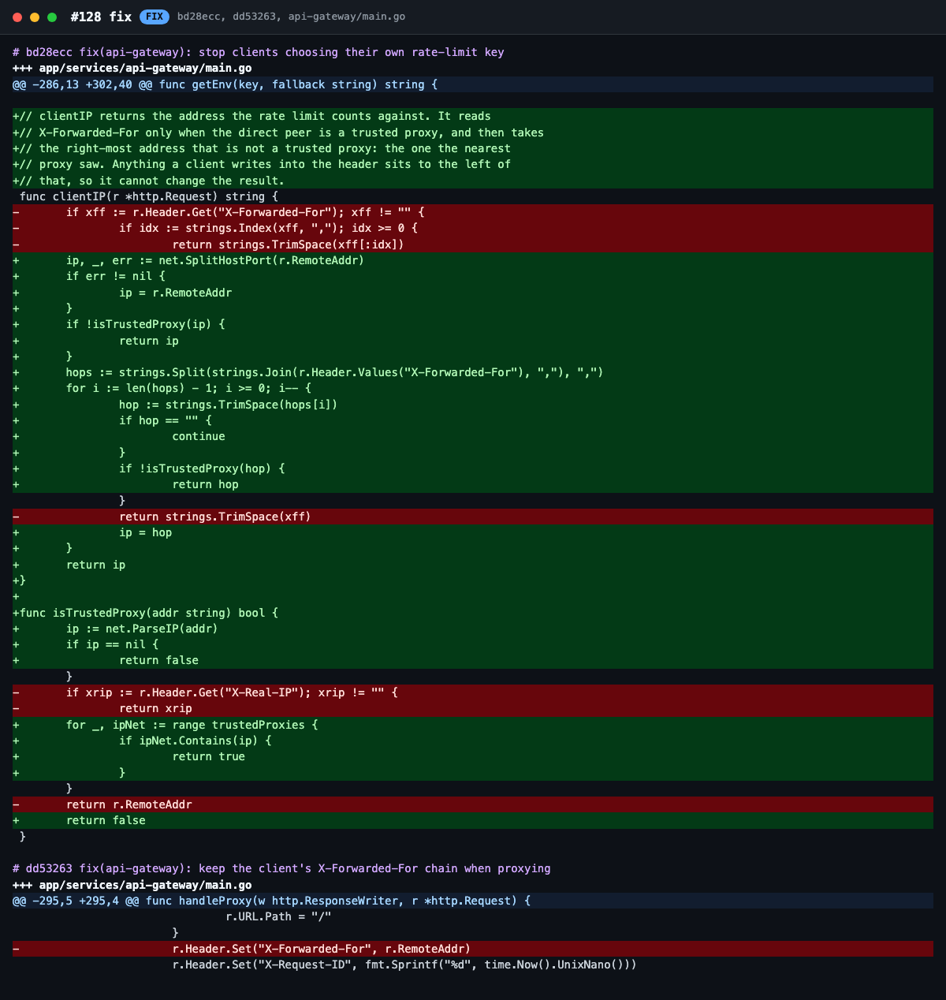

After, the same 150 requests give 100 × 200, 50 × 429 and one key. In the second part, `/api/notifications` points at a stub that echoes the `X-Forwarded-For` it receives. The client's chain arrives with the peer IP appended and no port.

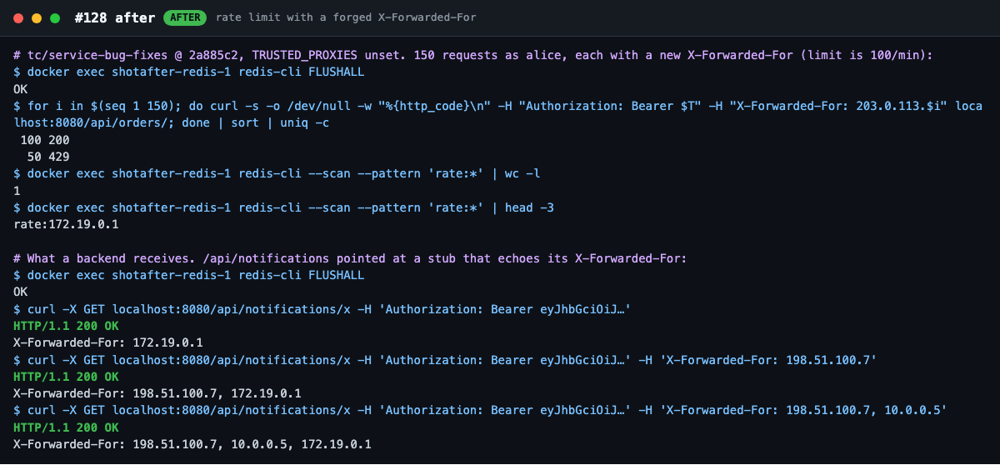

## #126: backends trust X-User-Email

[#126](https://github.com/tahmidachoudhury/aks-v2-platform/issues/126). order-service returns every order to a request with no `X-User-Email`, and bob reads alice's order.

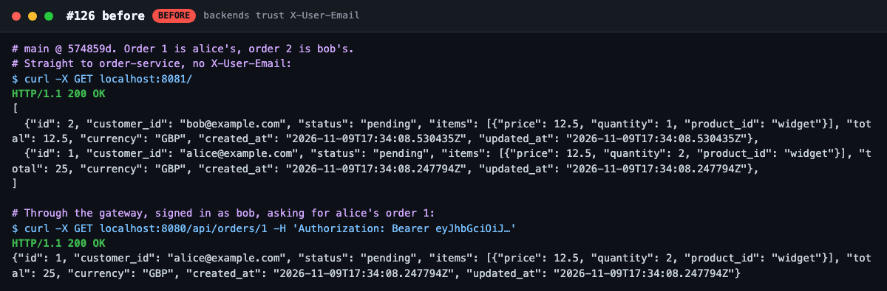

The gateway drops identity headers sent by the client, and every backend needs `X-User-Email` ([ae8a201](https://github.com/tahmidachoudhury/aks-v2-platform/commit/ae8a201)). Tokens now carry role `customer` or `admin`, and customers only see and change their own data ([e467409](https://github.com/tahmidachoudhury/aks-v2-platform/commit/e467409)). A customer can only cancel their own order. Any other status change needs admin or service ([27bf031](https://github.com/tahmidachoudhury/aks-v2-platform/commit/27bf031)). The image shows order-service. The other backends follow the same rules.

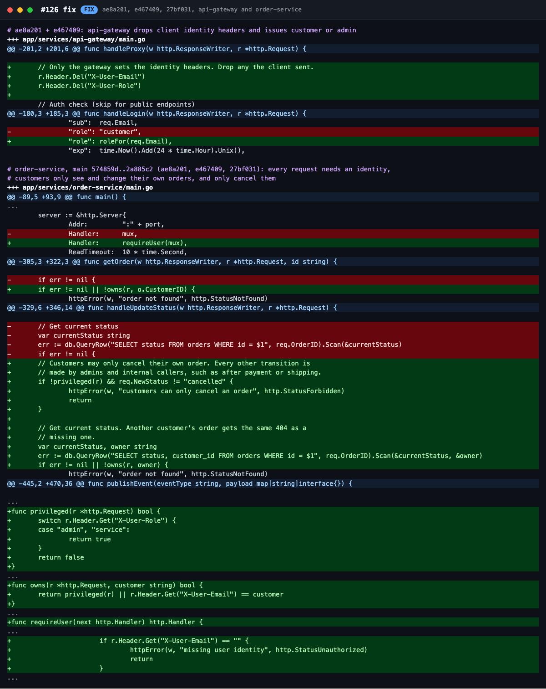

After, the request with no header gets 401. Bob gets 404 on alice's order and still reads his own. Bob gets 404 trying to cancel alice's order, and alice gets 403 trying to mark her own order delivered.

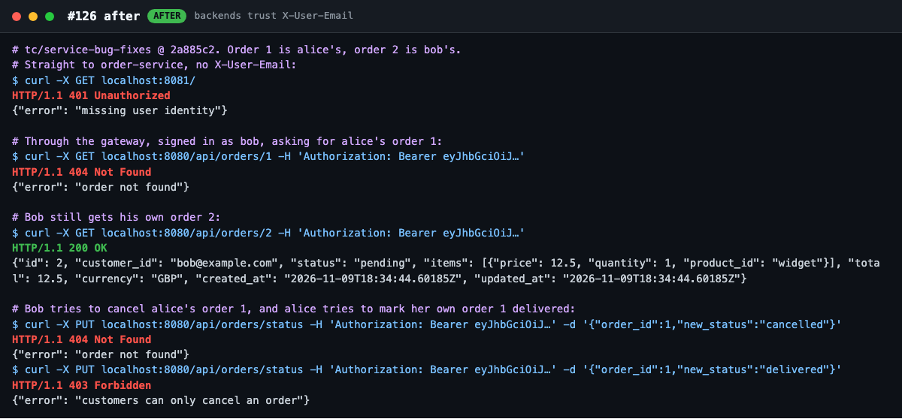

## #124: charge ignores ledger and commit errors

[#124](https://github.com/tahmidachoudhury/aks-v2-platform/issues/124). A `CHECK (false)` constraint makes every ledger insert fail. The charge still returns 201 `completed` with no payment row, and the worker confirms the order.

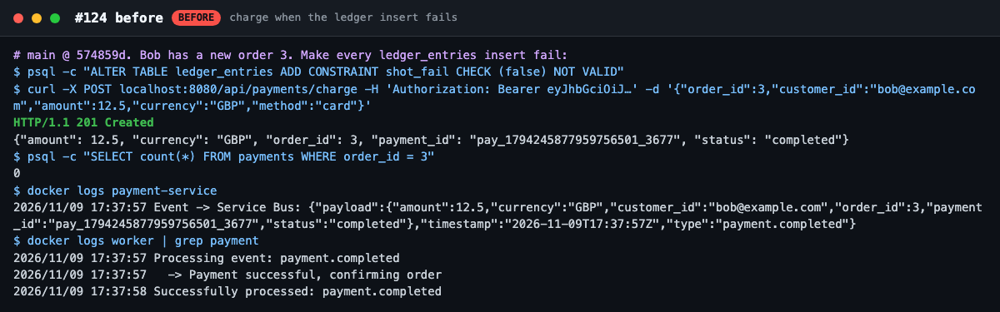

Both ledger inserts and the commit now return 500 on error, before any event is published ([983f2b5](https://github.com/tahmidachoudhury/aks-v2-platform/commit/983f2b5)).

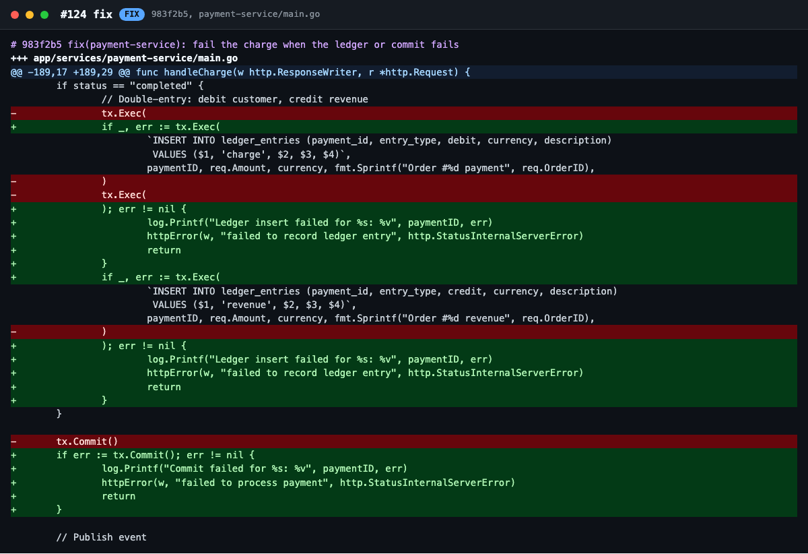

After, the same charge, made by the admin, returns 500 and publishes no event.

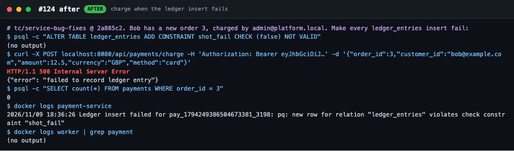

## #127: shipping webhook has no auth

[#127](https://github.com/tahmidachoudhury/aks-v2-platform/issues/127). A webhook with no secret and status `delivered.FAKE` returns 200 and writes that status to the shipment.

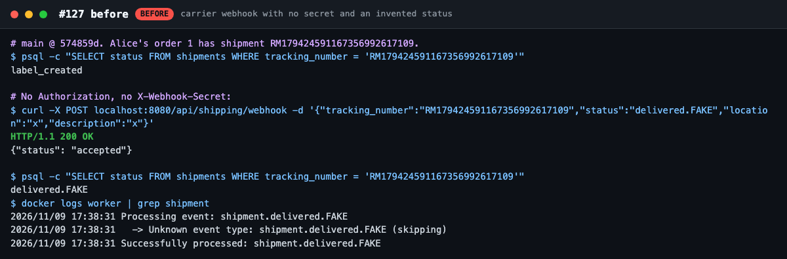

The webhook now checks `X-Webhook-Secret` against `SHIPPING_WEBHOOK_SECRET`, and accepts only four known statuses ([37c36b6](https://github.com/tahmidachoudhury/aks-v2-platform/commit/37c36b6)).

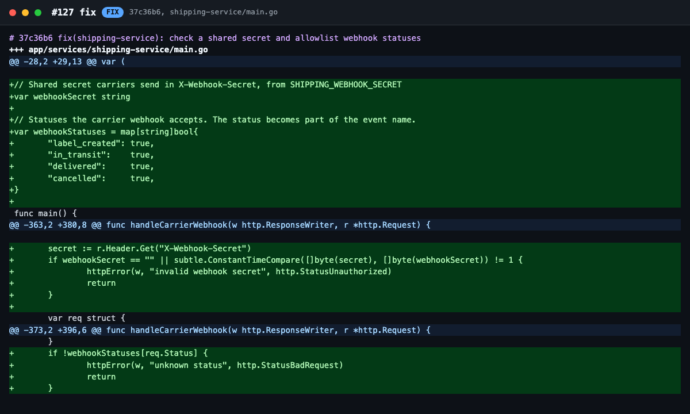

After, it returns 401 without the secret and 400 for the invented status. A known status still works.

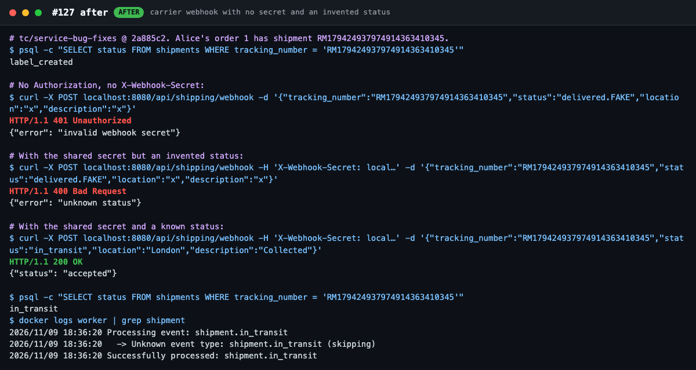

## #123: scheduler cancels orders outside the state machine

[#123](https://github.com/tahmidachoudhury/aks-v2-platform/issues/123). The scheduler cancels a pending order with 3 widgets reserved, backdated 31 minutes. No `order_events` row is written, the reservation stays active, and the log line carries alice's email.

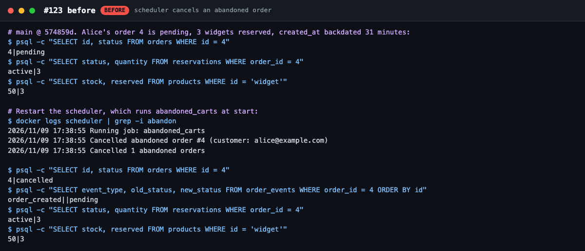

The scheduler now cancels through order-service's `/status` and releases stock through inventory-service ([c117707](https://github.com/tahmidachoudhury/aks-v2-platform/commit/c117707)). It no longer logs the customer ([2465958](https://github.com/tahmidachoudhury/aks-v2-platform/commit/2465958)).

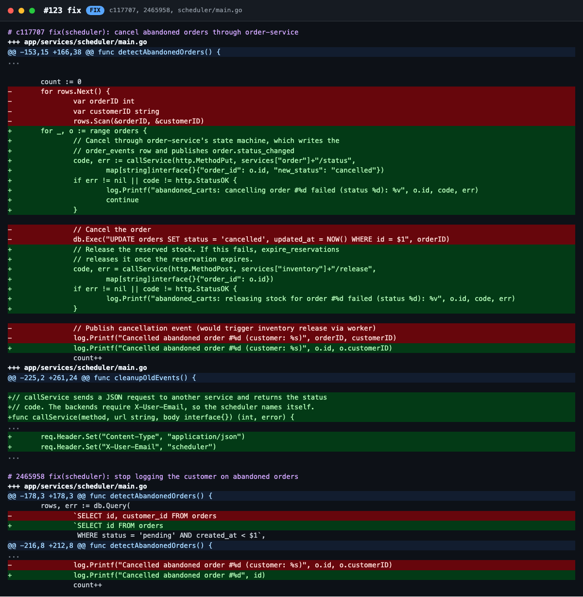

After, there is a `pending → cancelled` row, the reservation is released, and the log line shows only the order ID.

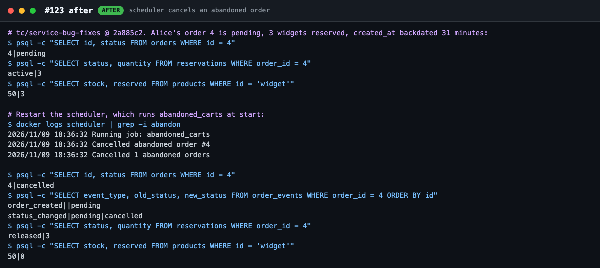

## #19: graceful shutdown on SIGTERM

[#19](https://github.com/tahmidachoudhury/aks-v2-platform/issues/19). SIGTERM to order-service under load through the gateway. The process exits at once, and the gateway returns 502s.

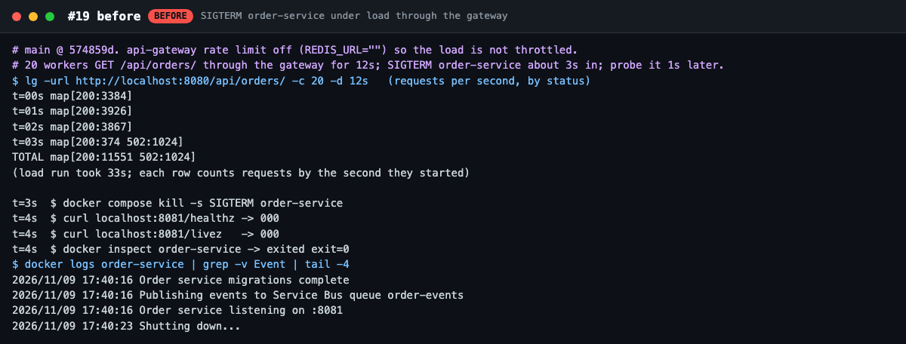

Each HTTP service now fails `/healthz` on SIGTERM, keeps serving for `SHUTDOWN_DRAIN_DELAY` (5s), then lets in-flight requests finish ([961657d](https://github.com/tahmidachoudhury/aks-v2-platform/commit/961657d)). The scheduler waits at most `SHUTDOWN_TIMEOUT` (20s) for running jobs ([d942eae](https://github.com/tahmidachoudhury/aks-v2-platform/commit/d942eae)), and every job, not only `abandoned_carts`, stops on shutdown ([4063259](https://github.com/tahmidachoudhury/aks-v2-platform/commit/4063259), after these images were taken). Compose starts it after order-service and inventory-service ([0521b4c](https://github.com/tahmidachoudhury/aks-v2-platform/commit/0521b4c)).

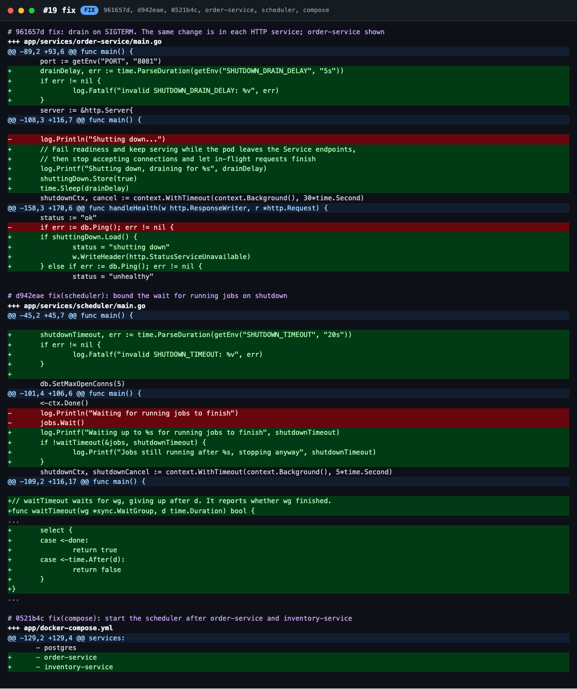

After, requests keep returning 200 through the 5s drain, while `/healthz` returns 503 and `/livez` returns 200. Compose has no readiness check, so the 502s after the drain, once the container has exited, are expected. Stopping the scheduler logs the bounded wait.

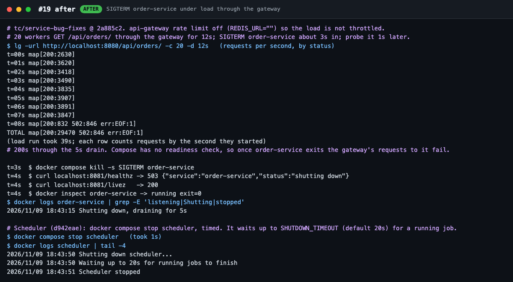

## Other fixes on this branch

These have no screenshots and are not tied to one of the nine bugs.

- [2e6ab6d](https://github.com/tahmidachoudhury/aks-v2-platform/commit/2e6ab6d): the gateway matches route prefixes on a `/` boundary, so `/api/ordersfoo` no longer reaches order-service.
- [ea224f2](https://github.com/tahmidachoudhury/aks-v2-platform/commit/ea224f2): payment-service locks the payment during a refund and checks every write.
- [dfc5544](https://github.com/tahmidachoudhury/aks-v2-platform/commit/dfc5544): notifications, reservation expiry and the dashboard stop ignoring database errors.
- [d2c75a3](https://github.com/tahmidachoudhury/aks-v2-platform/commit/d2c75a3): notification-service fills template placeholders from the request data.
- [22edf76](https://github.com/tahmidachoudhury/aks-v2-platform/commit/22edf76): shipping-service returns shipments with NULL columns instead of a 404.
- [01e8e66](https://github.com/tahmidachoudhury/aks-v2-platform/commit/01e8e66): inventory-service claims reservations before `/release` returns their stock, so release and expiry cannot both return it.
- [12edbc5](https://github.com/tahmidachoudhury/aks-v2-platform/commit/12edbc5): shipping-service handles NULLs and errors in the shipment list and the owner lookup.
- [8c9a640](https://github.com/tahmidachoudhury/aks-v2-platform/commit/8c9a640): notification-service renders template numbers as the request wrote them.
- [ce76f7a](https://github.com/tahmidachoudhury/aks-v2-platform/commit/ce76f7a): payment-service rounds refunds to pence and fails `/balance` on query errors.
